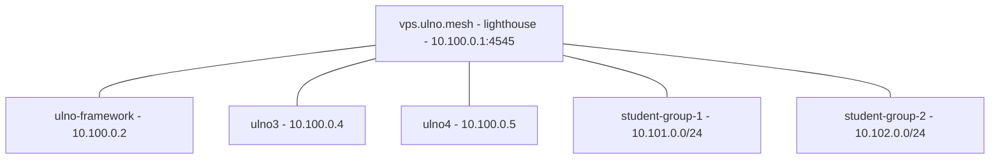

# User stories & guiding examples

These two stories are the **guiding examples** for nebula-manager's workflow. They
describe the intended end-to-end experience and double as a spec: steps marked
**⚙️ planned** are not implemented yet and exist to steer development; steps
marked **✅ today** work with the current tool.

> Motivation: on a host where Nebula is **already installed and running**, the
> first thing the tool should do is **discover what is there** and offer to
> generate `nebula-manager.conf` from it — not ask for a config that the user
> doesn't have yet. See *Story 1 / Phase 0*.

## The two config files (don't mix them up)

| File | Purpose | Typical location |
|---|---|---|
| **`nebula-manager.conf`** | the **tool's** config: `[global]` + `[server.NAME]` sections | `~/.config/nebula-manager/nebula-manager.conf` (or `/etc/nebula/nebula-manager.conf`) |
| **Nebula `config.yml`** | **Nebula's** runtime config: `pki`, `lighthouse`, `listen`, `firewall`, `tun` | `/etc/nebula/config.yml` |

The tool *manages* Nebula `config.yml` files, and *is configured by* `nebula-manager.conf`.

---

## Story 1 — Ulno, the networking teacher

**Situation.** Ulno teaches a Nebula class. He already runs Nebula by hand:

- a **lighthouse** on a VPS: `vps.ulno.mesh` = `10.100.0.1`, reachable at
  `vps.ulno.net:4545`;
- his laptop `ulno-framework.ulno.mesh` = `10.100.0.2` (a **client**);
- an existing **CA** with certs in `~/keys/nebula` (CA name `UlnoMeshCA`);
- Nebula runs as a **systemd service** (as the `nobody` user), so
  `/etc/nebula/config.yml` is root/service-owned;
- `listen.port: 0` (the OS assigns the UDP port, e.g. `54143`).

He does **not** use nebula-manager yet. He wants to: (a) import this setup,
(b) add two more home machines, (c) hand out per-student profiles.



### Phase 0 — Import the existing setup (⚙️ planned)

Today he would have to create a config by hand. The **intended** experience is a
single discovery pass:

```bash
$ nebula-manager import
Detected a running Nebula installation:
  service:      nebula.service (active)
  nebula:       /usr/bin/nebula (v1.11.2)
  config:       /etc/nebula/config.yml   (service-owned; readable with sudo)
  certs:        /home/ulno/keys/nebula   (CA: UlnoMeshCA, 3 certs)
  tun:          nebula1 (10.100.0.2/24, up)
  lighthouse:   10.100.0.1 -> vps.ulno.net:4545
  this host:    client (am_lighthouse: false)

Proposed nebula-manager.conf -> ~/.config/nebula-manager/nebula-manager.conf

  [global]
  bin_path=/usr/bin
  cert_dir=/home/ulno/keys/nebula
  default_port=4545

  [server.ulno-framework]
  dir=/etc/nebula
  service=/etc/systemd/system/nebula.service
  enabled=true

Write this file? [Y/n]
```

What the importer must detect (spec):

- **service(s):** `systemctl list-units 'nebula*'` / `show -p MainPID` → unit + state; path of the unit file; the `User=` it runs as.
- **binaries:** `command -v nebula nebula-cert` and `nebula --version` (sets `bin_path`).
- **config(s):** for each unit, the `-config` path from `ExecStart` (fallback `/etc/nebula/config.yml`); parse `tun.dev`, `listen.port`, `lighthouse.am_lighthouse`, `static_host_map`, `pki.{ca,cert,key}`.
- **certs:** the `pki.ca/cert/key` directory, plus any `$NEBULA_KEYS_DIR` / `~/keys/nebula` / `$NEBULA_DIR/certs`; count CAs/certs to propose `cert_dir`.
- **port:** if `listen.port` is `0`/unset, auto-detect from the running process (as `diag` already does).
- **read-only:** reading service-owned files only when needed, with a **reason + command** shown before any sudo prompt (never silently).

Until then, the ✅ workaround is:
```bash
nebula-manager config init          # write ~/.config/nebula-manager/nebula-manager.conf
nebula-manager config edit          # replace [server.nebula-example1] with your real server(s)
```

### Phase 1 — Register the existing members (⚙️ planned helper)

```bash
$ nebula-manager server add ulno-framework --dir /etc/nebula --service nebula.service
$ nebula-manager server add vps --role lighthouse --dir /etc/nebula --host vps.ulno.net:4545
$ nebula-manager cert list --cert-dir ~/keys/nebula
  Name                          Type  IPs            Groups
  UlnoMeshCA                    CA    -              -
  ulno-framework.ulno.mesh      Cert  10.100.0.2/24  laptops
  vps.ulno.mesh                 Cert  10.100.0.1/24  lighthouse,servers
```

### Phase 2 — Add home machines ulno3 and ulno4 (mostly ✅ today)

Sign certs unprivileged in the existing workspace:

```bash
$ nebula-manager sign --cert-dir ~/keys/nebula \
      --name ulno3.ulno.mesh --ip 10.100.0.4/24 --groups laptops
$ nebula-manager sign --cert-dir ~/keys/nebula \
      --name ulno4.ulno.mesh --ip 10.100.0.5/24 --groups laptops

$ nebula-manager cert bundle ulno3.ulno.mesh ./bundles
$ nebula-manager cert bundle ulno4.ulno.mesh ./bundles
```

Each bundle (`./bundles/ulno3.ulno.mesh-nebula-bundle.zip`) contains the cert, key,
`ca.crt` and a `config.yml.template` (with `static_host_map`/`lighthouse.hosts`
placeholders). He also edits the **firewall** so home machines can talk to each
other without restrictions:

```yaml
firewall:
  inbound:
    - port: any
      proto: any
      group: laptops          # laptops talk to laptops
  outbound:
    - port: any
      proto: any
      host: any
```

On each new machine (✅ today, manual):

```bash
git clone https://github.com/<you>/nebula-manager    # brings ./nebula-manager + ./lib
cd nebula-manager
./nebula-manager config init                         # create the tool config
./nebula-manager config edit                         # add [server.ulno3] with dir/service
unzip ~/ulno3.ulno.mesh-nebula-bundle.zip -d ~/nb
# install Nebula + place files (sudo only where needed):
sudo install -d /etc/nebula
sudo cp ~/nb/{ca.crt,ulno3.ulno.mesh.crt,ulno3.ulno.mesh.key} /etc/nebula/
sudo cp ~/nb/config.yml.template /etc/nebula/config.yml   # then edit static_host_map + lighthouse.hosts
./nebula-manager            # TUI -> Maintenance -> install/enable the service, then Toggle
./nebula-manager diag       # verify TUN ip, UDP socket, cert expiry
```

⚙️ Planned convenience: `nebula-manager client-setup <bundle.zip>` that unpacks,
places files under `/etc/nebula`, patches the unit's config path, enables the
service, and runs `diag` — elevating only for the individual system steps.

### Phase 3 — Two student groups of three machines (⚙️ planned "profiles")

Ulno wants two isolated class networks and a ready-to-hand-out collection per
group. ⚙️ Proposed:

```bash
$ nebula-manager profile create student-group-1 \
      --ca ~/keys/nebula \
      --lighthouse 10.100.0.1 \
      --subnet 10.101.0.0/24 \
      --members alice,bob,carol \
      --groups students,g1

$ nebula-manager profile create student-group-2 \
      --subnet 10.102.0.0/24 \
      --members dave,erin,frank \
      --groups students,g2

$ ls dist/
student-group-1/  student-group-2/
student-group-1/
  alice-nebula-bundle.zip
  bob-nebula-bundle.zip
  carol-nebula-bundle.zip
  ca.crt
  README.txt
  install.sh              # tiny helper; detects OS, places files, starts nebula
```

A **profile** bundles: per-member cert/key + `config.yml` template (lighthouse
pointed at `vps.ulno.net:4545`), the shared `ca.crt`, and a `README` + install
script. Firewall rules restrict each group to its own `subnet`, so groups can't
see each other.

What a profile must produce (spec): certs with `--groups <group>` and a
`--subnets`/`local_cidr` scope, a `config.yml` per member, the CA, and a
portable install/README. This is essentially `cert bundle` × N + shared assets.

---

## Story 2 — The students join

Names: **Alex** (Windows 11), **Bianca** (Linux/Fedora), **Chen** (macOS).
Each receives `student-group-1/<their>-nebula-bundle.zip` (or the whole folder)
from Ulno.

### Bianca — Linux ✅ (fully scriptable)

```bash
sudo dnf install -y nebula   # or install the binary from a release
git clone https://github.com/<you>/nebula-manager
cd nebula-manager
./nebula-manager config init
./nebula-manager config edit               # [server.student-group-1] dir=/etc/nebula service=nebula.service
unzip ~/bianca-nebula-bundle.zip -d ~/nb
sudo install -d /etc/nebula
sudo cp ~/nb/{ca.crt,bianca.*.crt,bianca.*.key,config.yml.template} /etc/nebula/
sudo mv /etc/nebula/config.yml.template /etc/nebula/config.yml
# edit /etc/nebula/config.yml: static_host_map + lighthouse.hosts
./nebula-manager          # Maintenance -> Install to system -> Toggle service
./nebula-manager diag     # confirm 10.101.0.x/24 up, cert valid
```

### Chen — macOS ⚙️ partial (bash tool works; service = launchd)

`nebula-manager` runs under bash on macOS, but the **service** layer is systemd-
only today. ⚙️ Planned: detect `launchd` and manage a `LaunchDaemon`
(`/Library/LaunchDaemons/net.defined.nebula.plist`) with the same "reason +
command" sudo prompts. For now:

```bash
brew install nebula
./nebula-manager diag                 # diagnostics work
# place files under /etc/nebula (sudo), then load a LaunchDaemon by hand
```

### Alex — Windows ⚙️ manual today (documented bridge)

nebula-manager is a bash tool; on Windows we ship the bundle plus instructions.

- **Option A (recommended):** WSL2 — follow Bianca's Linux steps inside WSL
  (Nebula's TUN still binds to the host via WSL networking).
- **Option B (native):** download `nebula.exe`/`nebula-cert.exe` from the Nebula
  release matching the bundle, then place `ca.crt`, `alex.*.crt`, `alex.*.key`
  and `config.yml` (from the bundle) in `C:\ProgramData\nebula\`, and install the
  Nebula service (`nebula.exe -service install`, `-service start`).

⚙️ Planned: `nebula-manager profile` also emits a **per-OS README** and a
PowerShell snippet so Windows students have copy/paste steps; and a
`nebula-manager verify` mode that re-checks reachability to the lighthouse from
the student's machine.

---

## Capability map (today vs planned)

| Capability | Status |
|---|---|
| Create CA, sign certs, list/inspect/expiry, remove | ✅ today |
| Unprivileged cert workspace (`--cert-dir` / `NEBULA_KEYS_DIR` / auto-detect) | ✅ today |
| Client bundle (cert, key, `ca.crt`, config template) | ✅ today |
| Tool config resolution + `config init/refresh/edit` (offline template) | ✅ today |
| Diagnostics (TUN ip, UDP socket auto-detect, cert expiry) | ✅ today |
| iperf3 bench (server/client) | ✅ today |
| **`import`**: discover a running Nebula and generate `nebula-manager.conf` | ⚙️ planned |
| **`server add`**: build the `[server.*]` sections from a live install | ⚙️ planned |
| **`client-setup <bundle>`**: install a bundle + service on a new host | ⚙️ planned |
| **`profile create`**: group collections (N bundles + CA + README/install) | ⚙️ planned |
| macOS `launchd` service management | ⚙️ planned |
| Windows support (native) | ⚙️ planned (WSL documented) |

These stories are the acceptance criteria for the planned commands above.
