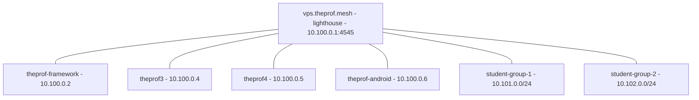

# User stories & guiding examples

These two stories are the **guiding examples** for nebula-manager's workflow. They
describe the intended end-to-end experience and double as a spec: steps marked
**⚙️ planned** are not implemented yet and exist to steer development; steps
marked **✅ today** work with the current tool.

> Motivation: on a host where Nebula is **already installed and running**, the
> first thing the tool should do is **discover what is there** and offer to
> generate `nebula-manager.conf` from it — not ask for a config that the user
> doesn't have yet. See *Story 1 / Phase 0*.

## The two config files (don't mix them up)

| File | Purpose | Typical location |
|---|---|---|
| **`nebula-manager.conf`** | the **tool's** config: `[global]` + `[server.NAME]` sections | `~/.config/nebula-manager/nebula-manager.conf` (or `/etc/nebula/nebula-manager.conf`) |
| **Nebula `config.yml`** | **Nebula's** runtime config: `pki`, `lighthouse`, `listen`, `firewall`, `tun` | `/etc/nebula/config.yml` |

The tool *manages* Nebula `config.yml` files, and *is configured by* `nebula-manager.conf`.

---

## Using it from the TUI (the main way)

Start the tool and everything is selectable from the text-graphical menus:

```bash
./nebula-manager        # or: nebula-manager
```

| Menu | Use it for |
|---|---|
| **Setup** | shows the detected state, then Import/Update / Create / Browse / Edit / Delete config, Manage servers, Certificate Workspace |
| **Servers** | List / Add / Enable-Disable / Remove `[server.*]` |
| **Certificates** | List / Create CA / Sign / View / Expiry / **Bundle-export client zip** (pick from a list) / Revoke / Switch workspace |
| **Configuration** | Validate / Edit Nebula `config.yml` / Firewall |
| **Connectivity** | ping all cert IPs (+ optional `iperf3`) |
| **Diagnostics** | TUN ip, UDP socket, cert expiry |
| **Benchmarks** | `iperf3` server / client |
| **Maintenance** | service toggle / update / auto-update scheduler / install / remove |

With no config yet, the tool opens **Setup** for you, showing what it detected
on this host (Nebula installed? a config already present? cert workspace?) before
offering to import, create or browse for one. The command lines shown in the
phases below are the **expert/automation** equivalents of the same menus.

---

## Story 1 — Theprof, the networking teacher

**Situation.** Theprof teaches a Nebula class. He already runs Nebula by hand:

- a **lighthouse** on a VPS: `vps.theprof.mesh` = `10.100.0.1`, reachable at
  `vps.theprof.demo:4545`;
- his laptop `theprof-framework.theprof.mesh` = `10.100.0.2` (a **client**);
- an existing **CA** with certs in `~/keys/nebula` (CA name `TheprofMeshCA`);
- Nebula runs as a **systemd service** (as the `nobody` user), so
  `/etc/nebula/config.yml` is root/service-owned;
- `listen.port: 0` (the OS assigns the UDP port, e.g. `54143`).

He does **not** use nebula-manager yet. He wants to: (a) import this setup,
(b) add two more home machines **and his Android phone**, (c) hand out
per-student profiles.



### Phase 0 — Import the existing setup (✅ available)

**TUI:** *Setup ▸ Import / update from this host*.

Today he would have to create a config by hand. The **intended** experience is a
single discovery pass (✅ available):

```bash
$ nebula-manager import
Detected a running Nebula installation:
  service:      nebula.service (active)
  nebula:       /usr/bin/nebula (v1.11.2)
  config:       /etc/nebula/config.yml   (service-owned; readable with sudo)
  certs:        /home/theprof/keys/nebula   (CA: TheprofMeshCA, 3 certs)
  tun:          nebula1 (10.100.0.2/24, up)
  lighthouse:   10.100.0.1 -> vps.theprof.demo:4545
  this host:    client (am_lighthouse: false)

Proposed nebula-manager.conf -> ~/.config/nebula-manager/nebula-manager.conf

  [global]
  bin_path=/usr/bin
  cert_dir=/home/theprof/keys/nebula
  default_port=4545

  [server.theprof-framework]
  dir=/etc/nebula
  service=nebula.service
  enabled=true

Write this file? [Y/n]
```

What the importer detects:

- **service(s):** `systemctl list-units/list-unit-files 'nebula*'` → unit name + `FragmentPath`, and the `-config` path from the unit's `ExecStart` (falls back to `/etc/nebula/config.yml`). If `systemctl` cannot reach the bus (containers, restricted shells) it **scans the unit files on disk** (`/etc/systemd/system`, `/run/systemd/system`, `/usr/lib/systemd/system`, `…/systemd/user`) instead.
- **binaries:** `command -v nebula` → proposes `bin_path`.
- **config keys:** `tun.dev`, `listen.port`, `lighthouse.am_lighthouse`, the first `static_host_map` peer, and `pki.ca` (whose directory becomes `cert_dir`).
- **certs:** the `pki` directory, else any detected store (`$NEBULA_KEYS_DIR`, `~/keys/nebula`, `$NEBULA_DIR/certs`, the default); counts `*.crt`.
- **port:** `listen.port`, or auto-detection when it is `0`/unset (same logic as `diag`).
- **read-only:** a privileged config is read only via a readable copy that **asks first and shows the reason + command** before any sudo prompt.

Flags: `--dry-run` (print only), `--yes` (write non-interactively), `--force`
(overwrite), `--from CONFIG` (use a specific Nebula config for discovery),
`--config OUT` (output path). It refuses to write without confirmation on a
non-tty unless `--yes` is given. Re-running it over an existing config keeps a
timestamped backup (`*.bak.YYYYmmdd-HHMMSS`) and updates in place. If nothing is
detected it falls back to:

```bash
nebula-manager config init          # write ~/.config/nebula-manager/nebula-manager.conf
nebula-manager config edit          # replace [server.nebula-example1] with your real server(s)
```

### Phase 1 — Register the existing members (✅ available)

**TUI:** *Servers ▸ Add Server* (list/enable/disable/remove in the same menu).

```bash
$ nebula-manager server add theprof-framework --dir /etc/nebula --service nebula.service
$ nebula-manager server add vps --role lighthouse --dir /etc/nebula --host vps.theprof.demo:4545
$ nebula-manager cert list --cert-dir ~/keys/nebula
  Name                          Type  IPs            Groups
  TheprofMeshCA                    CA    -              -
  theprof-framework.theprof.mesh      Cert  10.100.0.2/24  laptops
  vps.theprof.mesh              Cert  10.100.0.1/24  lighthouse,servers
```

Other subcommands: `server list` (table of `[server.*]` entries), `server remove NAME`,
`server enable|disable NAME`. `role`/`host` are stored as informational metadata;
the functional keys are `dir`, `service`, `enabled`.

### Phase 2 — Add home machines theprof3 and theprof4 (mostly ✅ today)

**TUI:** *Servers ▸ Add Server*, *Certificates ▸ Generate Client Certificate*,
*Certificates ▸ Bundle Client Zip*.

Sign certs unprivileged in the existing workspace. In the TUI the name and IP
are **pre-filled from the existing certs** (domain suffix `.theprof.mesh`, next
free address `10.100.0.4/24`) — just press Enter to accept:

```
[?] Enter the certificate name [theprof-framework.theprof.mesh]: theprof3.theprof.mesh
[?] Enter the IP address [10.100.0.4/24]:
[?] Enter the IP address [10.100.0.5/24]:    # next cert, after .4 is used
```

```bash
$ nebula-manager sign --cert-dir ~/keys/nebula \
      --name theprof3.theprof.mesh --ip 10.100.0.4/24 --groups laptops
$ nebula-manager sign --cert-dir ~/keys/nebula \
      --name theprof4.theprof.mesh --ip 10.100.0.5/24 --groups laptops

$ nebula-manager cert bundle theprof3.theprof.mesh --out ./bundles
$ nebula-manager cert bundle theprof4.theprof.mesh --out ./bundles
```

Each bundle (`./bundles/theprof3.theprof.mesh-nebula-bundle.zip`) contains the cert, key,
`ca.crt` and a `config.yml.template`. The template is populated from the running
Nebula config (or from the `[server.*]` entries + certificates): real
`static_host_map`/`lighthouse.hosts`, `punchy`, `listen`, `tun` and the firewall
policy. Anything that cannot be determined is flagged in the file and as a
warning instead of being silently left as a placeholder. He also edits the
**firewall** so home machines can talk to each other without restrictions:

```yaml
firewall:
  inbound:
    - port: any
      proto: any
      group: laptops          # laptops talk to laptops
  outbound:
    - port: any
      proto: any
      host: any
```

On each new machine (✅ today, manual):

```bash
git clone https://github.com/<you>/nebula-manager    # brings ./nebula-manager + ./lib
cd nebula-manager
./nebula-manager config init                         # create the tool config
./nebula-manager config edit                         # add [server.theprof3] with dir/service
unzip ~/theprof3.theprof.mesh-nebula-bundle.zip -d ~/nb
# install Nebula + place files (sudo only where needed):
sudo install -d /etc/nebula
sudo cp ~/nb/{ca.crt,theprof3.theprof.mesh.crt,theprof3.theprof.mesh.key} /etc/nebula/
sudo cp ~/nb/config.yml.template /etc/nebula/config.yml   # then edit static_host_map + lighthouse.hosts
./nebula-manager            # TUI -> Maintenance -> install/enable the service, then Toggle
./nebula-manager diag       # verify TUN ip, UDP socket, cert expiry
```

⚙️ Planned convenience: `nebula-manager client-setup <bundle.zip>` that unpacks,
places files under `/etc/nebula`, patches the unit's config path, enables the
service, and runs `diag` — elevating only for the individual system steps.

### Phase 2b — Theprof's Android phone (✅ today, mobile app)

Theprof wants the mesh on his phone while travelling. Mobile clients don't run
`nebula-manager`; the CA host prepares the certificate and the phone joins via
the **Mobile Nebula** app (Defined Networking).

**Which store?** The official app is on **Google Play** (Android) and the
**App Store** (iOS). It is **not on F-Droid** — that request was closed as not
planned (the app has no FOSS license). If he avoids Google Play, the project
publishes **`MobileNebula.apk`** on its GitHub releases page
(`DefinedNet/mobile_nebula`), which can be installed/updated with a tool like
Obtainium.

The key stays on the device: the app generates the keypair and exports only the
**public key**; the CA host signs it. Never copy `ca.key` to a phone.

1. Install **Mobile Nebula**, tap **+**, and create a site (e.g. `theprof.mesh`).
2. Open the site's **Certificate** screen and **share/export the public key**
   (e.g. `theprof-android.pub`) to the CA host.
3. On the CA host, sign that public key and emit a QR code for the certificate:

   ```bash
   cd nebula-manager                       # your checkout
   ./nebula-manager sign --cert-dir ~/keys/nebula \
     --in-pub ~/theprof-android.pub \
     --name theprof-android.theprof.mesh \
     --ip 10.100.0.6/24 --groups mobile \
     --qr ~/keys/nebula/theprof-android.png
   ```

   TUI equivalent: *Certificates ▸ Generate Client Certificate* → answer **yes**
   to “Is this certificate for a phone/tablet (Mobile Nebula)?” and give the
   exported public key; it writes no `.key` and defaults the QR to
   `<cert-dir>/<name>.png`.

   (`--qr` encodes the **certificate only** — the phone already holds the
   matching private key.)
4. In the app's **Certificate** screen scan `theprof-android.png` (or paste the
   `.crt` text). In the **CA** screen paste `ca.crt` (or scan a QR made with
   `qrencode -o ca.png < ca.crt`, if `qrencode` is installed).
5. In the app's **Hosts/lighthouse** section add the lighthouse: Nebula IP
   `10.100.0.1`, underlay `vps.theprof.demo:4545` (his lighthouse port),
   **lighthouse: on**.
6. Save, allow the VPN profile, and enable the site. Verify from the laptop:

   ```bash
   ping 10.100.0.6            # the phone's overlay IP
   ```

Notes:

- The cert name follows the same convention (`theprof-android.theprof.mesh`);
   `10.100.0.6/24` is the next free address after `.4`/`.5`.
- Group `mobile` is handy for firewall rules. The current config allows all, so
   nothing else is needed here; restrict/allow `mobile` wherever inbound rules
   are tightened.
- Recent app versions support **Always On** and importing a full `config.yml`;
   the cert + CA + lighthouse flow above is the portable path.
- `nebula-manager sign --in-pub … --qr …` (and the TUI mobile question) handles
   this step; it never writes a private key for a device-generated key.

### Phase 3 — Two student groups of three machines (⚙️ planned "profiles")

**TUI:** ⚙️ planned *Profiles ▸ Create group*.

Theprof wants two isolated class networks and a ready-to-hand-out collection per
group. ⚙️ Proposed:

```bash
$ nebula-manager profile create student-group-1 \
      --ca ~/keys/nebula \
      --lighthouse 10.100.0.1 \
      --subnet 10.101.0.0/24 \
      --members alice,bob,carol \
      --groups students,g1

$ nebula-manager profile create student-group-2 \
      --subnet 10.102.0.0/24 \
      --members dave,erin,frank \
      --groups students,g2

$ ls dist/
student-group-1/  student-group-2/
student-group-1/
  alice-nebula-bundle.zip
  bob-nebula-bundle.zip
  carol-nebula-bundle.zip
  ca.crt
  README.txt
  install.sh              # tiny helper; detects OS, places files, starts nebula
```

A **profile** bundles: per-member cert/key + `config.yml` template (lighthouse
pointed at `vps.theprof.demo:4545`), the shared `ca.crt`, and a `README` + install
script. Firewall rules restrict each group to its own `subnet`, so groups can't
see each other.

What a profile must produce (spec): certs with `--groups <group>` and a
`--subnets`/`local_cidr` scope, a `config.yml` per member, the CA, and a
portable install/README. This is essentially `cert bundle` × N + shared assets.

---

## Story 2 — The students join

Names: **Alex** (Windows 11), **Bianca** (Ubuntu), **Chen** (macOS), **Dana** (iPhone).
Desktop students receive `student-group-1/<their>-nebula-bundle.zip` (or the whole
folder) from Theprof; Dana receives her signed cert + `ca.crt` (and an optional
QR) for the mobile app instead.

### Bianca — Ubuntu ✅ (fully scriptable; Debian and Mint work the same)

Per-distribution details (Fedora/RHEL, Arch/CachyOS, SELinux, firewalls) are in
**[docs/linux-distros.md](linux-distros.md)**.

```bash
# Nebula + tooling from the Ubuntu archive
sudo apt update
sudo apt install -y nebula gawk curl findutils grep jq sed sudo systemd tar wget \
                    coreutils iperf3 iputils-ping whiptail zip
# yq v4 (only the firewall editor needs it): Ubuntu's archive yq is the old Python v3
sudo wget -qO /usr/local/bin/yq https://github.com/mikefarah/yq/releases/latest/download/yq_linux_amd64
sudo chmod +x /usr/local/bin/yq

git clone https://github.com/<you>/nebula-manager
cd nebula-manager
./nebula-manager config init
./nebula-manager config edit               # [server.student-group-1] dir=/etc/nebula service=nebula.service
unzip ~/bianca-nebula-bundle.zip -d ~/nb
sudo install -d /etc/nebula
sudo cp ~/nb/{ca.crt,bianca.*.crt,bianca.*.key,config.yml.template} /etc/nebula/
sudo mv /etc/nebula/config.yml.template /etc/nebula/config.yml
# edit /etc/nebula/config.yml: static_host_map + lighthouse.hosts
./nebula-manager          # Maintenance -> Toggle Nebula Service
./nebula-manager diag     # confirm 10.101.0.x/24 up, cert valid
```

> **Fedora:** `sudo dnf install -y nebula ... yq ...` (`yq` is v4 there).
> **Arch/CachyOS:** `sudo pacman -S nebula go-yq libnewt ...`.
> The rest of the steps are identical.

### Chen — macOS ⚙️ partial (bash tool works; service = launchd)

`nebula-manager` runs under bash on macOS, but the **service** layer is systemd-
only today. ⚙️ Planned: detect `launchd` and manage a `LaunchDaemon`
(`/Library/LaunchDaemons/net.defined.nebula.plist`) with the same "reason +
command" sudo prompts. For now:

```bash
brew install nebula
./nebula-manager diag                 # diagnostics work
# place files under /etc/nebula (sudo), then load a LaunchDaemon by hand
```

### Dana — iPhone ✅ (App Store mobile app)

Dana joins from iOS. There is no bash/`nebula-manager` on the phone (and no
sideloading), so Theprof prepares her credentials and she imports them into
**Mobile Nebula** from the App Store (free, iOS 15+). The App Store is the only
supported install path.

1. Dana installs **Mobile Nebula**, taps **+**, and creates a site
   (`student-group-1`).
2. In the site's **Certificate** screen she shares her device **public key**
   (`dana-iphone.pub`) with Theprof (AirDrop / Files / Mail).
3. Theprof signs it on the CA host (the private key never leaves her phone):

   ```bash
   ./nebula-manager sign --cert-dir ~/keys/nebula \
     --in-pub ~/dana-iphone.pub \
     --name dana-iphone.student-group-1.theprof.mesh \
     --ip 10.101.0.10/24 --groups students \
     --qr ~/keys/nebula/dana-iphone.png
   ```

4. He sends back `dana-iphone.png` (or the `.crt`) **and** `ca.crt`. She scans
   the cert in the **Certificate** screen, pastes `ca.crt` in the **CA** screen,
   and adds the lighthouse (`10.100.0.1` → `vps.theprof.demo:4545`).
5. Save, allow the VPN configuration, and enable the site. Verify from another
   group member: `ping 10.101.0.10`.

Notes:

- The bundle `.zip` is for the desktop Nebula binary; mobile students get the
   cert + CA (+ optional QR), not the zip.
- `10.101.0.10/24` is a free address in group 1's /24 (pick any unused one).
- Android works the same way (see Story 1, Phase 2b); the mobile app is **not**
   on F-Droid.

### Alex — Windows ⚙️ manual today (documented bridge)

nebula-manager is a bash tool; on Windows we ship the bundle plus instructions.

- **Option A (recommended):** WSL2 — follow Bianca's Ubuntu steps inside WSL
  (Nebula's TUN still binds to the host via WSL networking).
- **Option B (native):** download `nebula.exe`/`nebula-cert.exe` from the Nebula
  release matching the bundle, then place `ca.crt`, `alex.*.crt`, `alex.*.key`
  and `config.yml` (from the bundle) in `C:\ProgramData\nebula\`, and install the
  Nebula service (`nebula.exe -service install`, `-service start`).

⚙️ Planned: `nebula-manager profile` also emits a **per-OS README** and a
PowerShell snippet so Windows students have copy/paste steps; and a
`nebula-manager verify` mode that re-checks reachability to the lighthouse from
the student's machine.

---

## Capability map (today vs planned)

| Capability | Status |
|---|---|
| Create CA, sign certs, list/inspect/expiry, remove | ✅ today |
| Unprivileged cert workspace (`--cert-dir` / `NEBULA_KEYS_DIR` / auto-detect) | ✅ today |
| Client bundle (cert, key, `ca.crt`, config template) | ✅ today |
| Tool config resolution + `config init/refresh/edit` (offline template) | ✅ today |
| Diagnostics (TUN ip, UDP socket auto-detect, cert expiry) | ✅ today |
| iperf3 bench (server/client) | ✅ today |
| **`import`**: discover a running Nebula and generate `nebula-manager.conf` | ✅ today |
| **`server add/list/remove/enable/disable`**: manage `[server.*]` entries | ✅ today |
| **`client-setup <bundle>`**: install a bundle + service on a new host | ⚙️ planned |
| **`profile create`**: group collections (N bundles + CA + README/install) | ⚙️ planned |
| macOS `launchd` service management | ⚙️ planned |
| Windows support (native) | ⚙️ planned (WSL documented) |

These stories are the acceptance criteria for the planned commands above.
